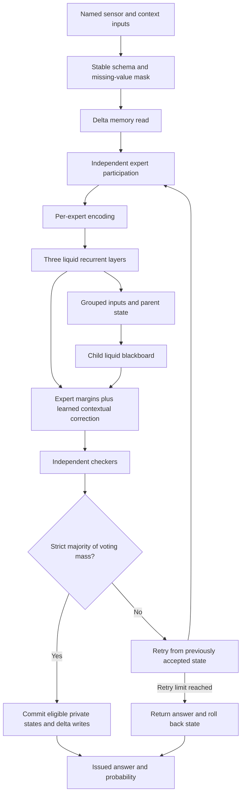
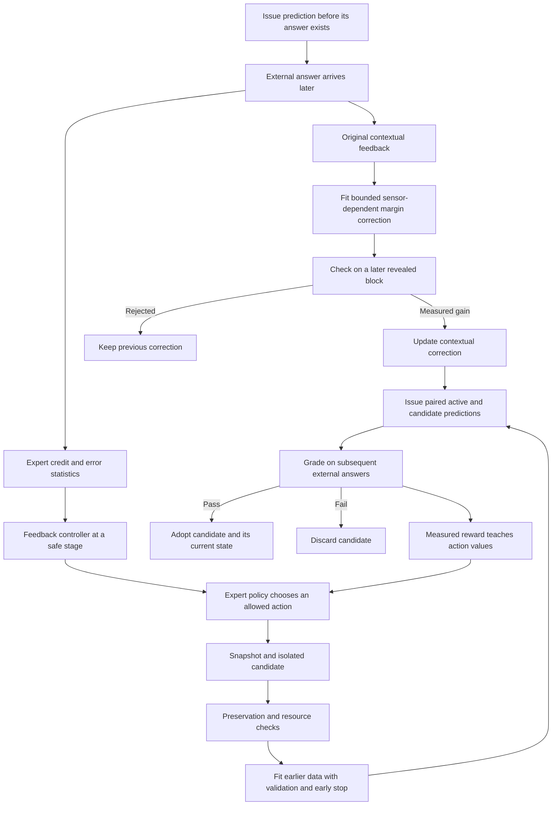
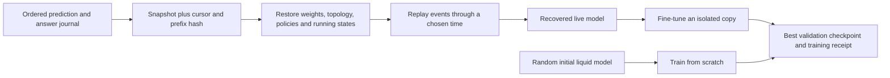

# How the adaptive liquid board works

This document explains the running model, its learning paths, its growth rules and its recovery workflow. Start with [README.md](README.md) for commands and [RESULTS.md](RESULTS.md) for measured outcomes.

## Prediction and memory



The root starts from the supplied checkpoint. Each expert keeps its three liquid recurrent layers. Their conductances determine how quickly state follows new evidence. The encoding, checkers, readouts and control policies are conventional learned layers around these liquid dynamics.

Experts choose whether to participate independently. A board may receive no usable votes. Its checkers can challenge a particular expert before commitment. A retry does not silently retain a failed proposal's state. Each child applies the same protocol, using its selected inputs and its parent's private liquid state.

A child's learned connection starts at zero. Adding the child therefore preserves the parent's answer before fitting. After fitting, the connection can contribute bounded log odds to the parent's final margin. Parent checks still apply. Child state commits only when its parent participated, survived its checks and belonged to a committed parent round.

Every shared child has separate running state for each parent path. Sharing parameters does not merge memories. Whole-board sharing preserves corresponding head memory even when the equal heads have different lifecycle identities. Elapsed times use float64 timestamps so real Unix dates retain five-minute differences.

## Two learning paths run together



The contextual path is the algorithm in the original `contextual.py`. It remains active while a structural candidate is tested. Rejecting a larger network does not freeze contextual learning.

The original learner fits a regularized residual to the board's earlier probabilities. Its inputs contain bounded values, missingness indicators and a constant. It chooses a correction step using fitting data only. A separate later block decides whether the correction is retained. Those check predictions are replayed under the original protocol; they are not falsely described as prospectively issued candidate predictions.

The structural path uses actual paired predictions issued before their answers arrive. Both graphs receive the same accepted contextual correction while the trial runs. The structural comparison therefore measures the proposed capacity or weight change alongside continuing contextual adaptation. Expert weights remain fixed during the check; the shared contextual correction can change.

An accepted structural change preserves the correction already learned. Its contextual replay history restarts because old expert and head axes may no longer match. The audit keeps the preceding decisions. A new schema also restarts that replay history after expanding the correction's named columns.

## Reinforcement credit for structural actions

The policy is a neural contextual bandit, a reinforcement learner for one measured action return at a time. It is not a long-horizon actor-critic or a policy-gradient algorithm.

| Part | Meaning |
| --- | --- |
| Observation | Expert liquid state, measured error and credit, age, activity, confidence, depth, new inputs and child ownership |
| Action | Learn weights, split a peer, create a child, split an encoding neuron, retire, share, grow heads or prune heads |
| Action mask | Controller pressure, gradient signal, cooldown, measured lifetime and configured capacity limits |
| Exploration | Random choice among allowed actions, with a configured probability |
| Return | Balanced Brier improvement plus a configured parameter-saving reward |
| Rejection | Negative return, including unsupported or harmful candidates |
| Replay | Bounded observations, actions and returns retained inside each policy's checkpoint |
| Update | Smooth-L1 regression of selected action values against measured returns |

The runtime first chooses which expert may propose, using masked policy utilities. That expert chooses its operation. Its action head learns from the delayed trial return. Policies share measured experiences but evaluate their own current contexts. Replay prevents a single latest return from erasing the entire learning signal.

An accepted action receives at least the configured positive minimum reward. A rejected action receives at most its negative counterpart. This gives a definite training signal even when measured improvement is zero. Quality gates still decide adoption; a high action value cannot bypass them.

The grouping head learns a separate signal: correlation between an input and the expert's residual errors. Its configured top fraction selects a child's input group. This is a relevance heuristic, not causal identification.

## What can grow and shrink

| Change | Initialization and state mapping | Retention rule |
| --- | --- | --- |
| Expert split | Clone one expert and its context; divide its voting mass between donor and peer | Later accuracy, Brier, class and quorum gains must pass |
| Child board | Copy one expert into a full board; start parent connection at zero | Same measured growth gates |
| Encoding-neuron split | Duplicate incoming weights; divide outgoing weights between the two units | Same measured growth gates |
| Attention-head split | Copy a selected head's projections and memory; divide its readout contribution | Same preservation and measured growth gates |
| Expert retirement | Remove the selected expert; collect branches with no parent | Save parameters with no measured class, Brier or quorum deterioration |
| Attention-head pruning | Remove the least readout mass and its private memory axis | Same no-harm rule; never cross the configured minimum |
| Weight sharing | Tie exactly equal liquid kernels or compatible complete boards | Save parameters without measured harm |

Peer splits preserve total voting mass. A strict majority means more than half of that mass. Initially, five unit masses reproduce the original three-of-five rule. Splitting an expert does not manufacture an extra vote.

Encoding width and liquid state width are different. Encoding width can grow. Each liquid state layer remains width eight. This implementation does not claim to split a solver's internal state coordinate.

### Dynamic delta attention

Every head has four coordinates and a four-by-four memory. The network starts with the reference's two heads. Configured bounds default to one through eight heads per board.

For each head, the projections produce a normalized key, a target, diagonal forgetting and an update rate. The memory update is:

```text
past = memory * exp(-softplus(forgetting) * elapsed_minutes / 15)
error = tanh(target) - transpose(key) * past
memory_next = past + outer(key, sigmoid(rate) * error)
```

A normalized query reads each head. A learned output map combines the head results into eight coordinates for the liquid experts. Its initial identity map reproduces the original two-head readout.

Growth duplicates the head with the greatest squared readout mass. Dividing its old readout between two identical heads preserves the represented function. The copies can diverge during fitting. Pruning proposes the least readout mass. A small mass is a proposal signal; subsequent outcomes still decide removal.

Head identities survive checkpoints. New heads inherit donor memory. Removed heads lose their memory axis. Every parent context is remapped separately. Head count changes only at mutation stages, with a fresh optimizer.

## Feedback control and limits

The controller tracks balanced error, changes between earlier and recent history, stalled improvement and a bounded accumulated error. Hysteresis uses separate conditions for entering and leaving growth pressure. A cooldown prevents immediate repeated structural attempts. Rejected growth increases the next pressure threshold.

A gradient probe uses earlier labels and bounded microbatches. The leading singular vector of an encoding-weight gradient selects a neuron to split. This is a gradient-directed heuristic inspired by GradMax. It does not reproduce GradMax's full optimization.

Pressure permits a trial. It does not accept a trial. Before fitting, the candidate must fit the parameter and context-use ceilings. The memory estimate includes weights, gradients, optimizer moments and padded activation work. It counts proposed context paths, including repeated uses of shared children. It is not a measurement of total Python process memory.

Configuration is split by purpose:

| File or model part | Controls |
| --- | --- |
| `configuration.json` | Live learning schedule, quality gates, policy learning, graph ceilings and controller settings |
| `training-configuration.json` | Offline training defaults, including up to 20 passes and early stopping |
| `guards.json` | Optional controller-only override for comparisons |
| Learned weights and buffers | Conductances, participation, margins, memory projections, readouts, contextual correction and action values |
| Original reference protocol | Three liquid layers, width-eight state, checker calculations and original contextual optimizer defaults |

Safety ceilings remain explicit caller choices. The network learns when to use capacity within them. It cannot authorize its own unlimited memory, depth or input scale. Configuration values are experiment settings, not claims that those values are universally correct.

## Fitting and early stopping

Training separates an earlier fitting prefix from a later validation tail. Both come from already available training history. The future prospective check is not used for gradient fitting or early stopping.

Each pass uses fixed parameter shapes, truncated recurrent gradients and clipped gradient norms. A fresh AdamW optimizer starts at the stage boundary. Existing weights use the configured lower learning rate. New rows, heads, field columns and child connections warm up separately. Mixed tensors scale the final Adam update, since scaling a gradient alone can be cancelled by Adam's normalization.

Validation uses balanced Brier error. The fitter retains the best earlier snapshot and restores it on exit. It stops after the configured number of passes without enough improvement. If the initial weights remain best, it restores them. If the earlier data cannot provide both classes in fitting and validation, the receipt says so; it does not claim early stopping was measured.

The live configuration limits a candidate to one pass. The offline training configuration allows 20, with patience two. Change those values explicitly for another experiment. Every fit receipt records requested and completed passes, best epoch, validation history and the actual learning rates.

## Snapshots, recovery and new training



`Runtime.save` stores the whole model and its current work. This includes active and shadow graphs, pending labels, contextual histories, policy replay, controller state and random-generator state. Stage checkpoints recover the same mutation boundary. Retention controls how many numbered boundaries remain alongside the latest `boundary.pt`.

For point-in-time recovery, use `workflow.Journal`. It writes ordered prediction, answer, reset and discard events, flushing each event to disk. A snapshot records its checkpoint hash, event cursor and the hash of the journal prefix. Recovery checks those values, restores the snapshot and replays only events through the chosen time. It rejects missing sequences, altered history and a time earlier than the snapshot.

Recovery cannot reconstruct events that were never journaled. Use an earlier snapshot when rolling back before the latest one. Continue a recovered branch in a new journal so its future cannot be confused with the original branch.

Scratch training creates random liquid weights. Fine-tuning copies a saved graph, preserving its learned topology and correction. Both fit an isolated model and write a new checkpoint plus a training receipt. Neither silently replaces a running service. A timestamp cutoff can exclude later training rows after a point-in-time restore.

## Code map

| File | Responsibility |
| --- | --- |
| `reference.py` | Import unchanged reference classes, features, data parser and scoring protocol |
| `graph.py` | Expert boards, named schemas, hierarchy, voting mass, structural mutations, sharing and contextual state mapping |
| `attention.py` | Variable delta heads, forgetting, readout splits and head-memory remapping |
| `adaptation.py` | Run the original contextual learner against the whole graph and serialize its replay history |
| `policy.py` | Per-expert action values, bounded reinforcement replay and learned input groups |
| `control.py` | Error feedback, hysteresis, lifetime, cooldown, gradient probes and resource estimates |
| `runtime.py` | Ordered inference and labels, isolated trials, fitting, early stopping, adoption and full checkpoints |
| `workflow.py` | Journals, point-in-time recovery, scratch training, fine-tuning and snapshot inspection |
| `compare.py` | Same-data comparisons, actual original contextual rerun and saved predictions |
| `verify.py` | Independent score, gate, chronology, fingerprint and restored-topology checks |
| `demonstrate.py` | Controlled synthetic adaptation, kept separate from occupancy claims |
| `test_adaptive.py` | Behavioral checks of reference fidelity, dynamic operations, learning and recovery |

The [requirement map](README.md#requirement-to-evidence-map) connects these parts to individual tests. The [results](RESULTS.md) record what the larger architecture actually did on the reference datasets.
