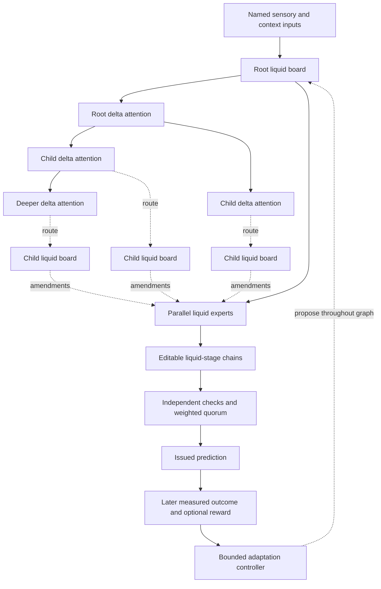
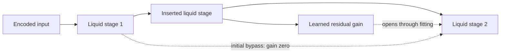
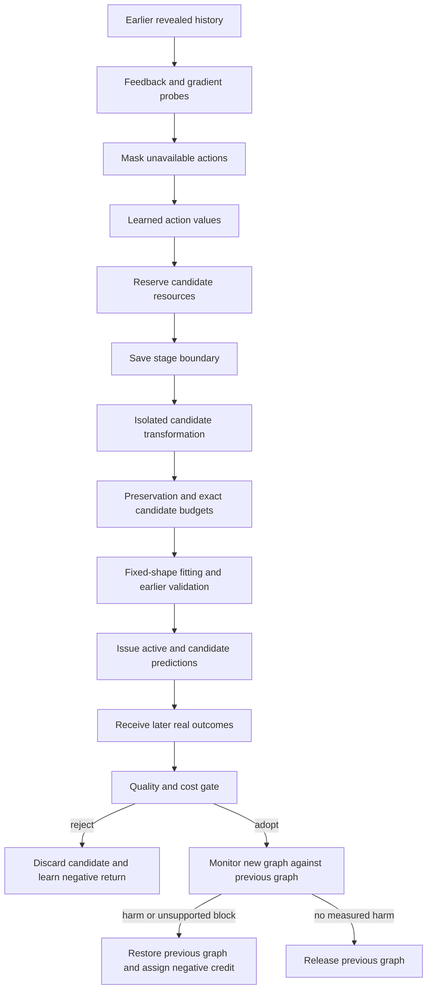

# Architecture and adaptation

[Inspect observed before/during/after networks and the full adaptation lifecycle](EVOLUTION.md).

## One graph, several levels of adaptation

Every network is a complete liquid board: private expert state, participation, independent checkers, retries, weighted quorum, contextual correction and delta memory. A board's delta memory is now a tree. Each node has its own trainable heads, forgetting and readout. An expert's child edge names the attention node that routes it. Several child networks can use the same attention node, and several context paths can share network weights.



This is a directed, nested computation graph. Temporal recurrence occurs inside conductance neurons and delta memories. The graph does not grow structural cycles. Horizontal growth covers peers, heads, sibling attention nodes and independent network forks. Vertical growth covers liquid stages, child attention levels and child boards. Bounds apply across the entire graph, including repeated execution of shared descendants.

## Liquid state and neuron width

`LiquidNeurons` retains the native conductance solver. With input `x`, state `h`, elapsed time and positive conductances, each original solver substep is:

```text
h_next = (h + dt * drive(x, h)) / (1 + dt * decay(x, h))
```

The strengths use softplus, targets and resting values use tanh, and recurrent gates use sigmoid. The original two solver substeps per stage remain. A stage can have a different internal neuron count from another stage. Independent experts in the same board use batched parameter tensors, so a width mutation changes the coordinate count for every expert in that stage, while their weights remain separate.

A learned readout maps each stage's variable internal state to eight public coordinates. Those public coordinates keep mixers, parent context, policies and attention compatible. Eight is an interface size, not a fixed internal LTC width. The initial readout is the identity; the initial eight-neuron model follows the native inference path exactly.

A recurrent split copies a selected destination neuron and its state. It also duplicates that neuron's outgoing recurrent source row. The two source rows each receive half its positive conductance, using inverse softplus to represent that half in parameter space. The public readout mass is divided between the twins. Leak, resting potential, gates and targets are copied. Identical states then produce the same total drive and decay before learning, up to floating-point roundoff. It is not enough to copy a recurrent row without dividing conductance: that would alter both drive and decay.

A prune removes the selected source row, destination column, state coordinate and readout row. It changes the function and must pass later no-harm checks. Stable neuron identities and donor mappings preserve the remaining state during either transformation. Checkpoints store those identities separately for every liquid layer.

## Editable liquid stages

Each stage has a trainable residual coefficient `g`. Its public output and margin contribution are:

```text
public_i = g_i * decode(raw_liquid_state_i) + (1 - g_i) * public_previous
margin_i = margin_previous + g_i * stage_readout_i(encoded, public_i)
```

The checker's contribution is also scaled by `g_i`. Existing stages start at one. A new stage copies compatible parameters, gets a stable layer identity and starts at zero. It can be inserted before, between or after existing stages. Its private liquid state may evolve, but its public contribution initially bypasses it. The same residual fold produces parent context, policy context and delta-write summaries. Otherwise a bypassed last stage could still change shared memory and break preservation on the next observation.

Removing a stage deletes its cell, mixer, output, checker and residual coefficient. Remaining states align by layer identity, not list position. The default minimum is three stages to retain the original multi-checker protocol; the maximum is eight. Training holds the selected shape fixed for each optimizer pass.



## Delta-attention hierarchy

A tree node retains the original four-coordinate delta heads. Before a write, memory forgets according to elapsed time:

```text
past = memory * exp(-softplus(forget) * minutes / 15)
memory_next = past + key outer (rate * (target - key_transpose * past))
```

Keys are normalized and rates use sigmoid. A node's head readouts combine into eight public coordinates. Head splitting copies memory and divides readout mass; pruning removes a head only above its minimum. These operations can target any attention node, not just the root.

A child node reads with the parent query and recalled context. Its tanh-gated contribution adds to the parent's read. A new node starts with zero contribution, preserving the current public read. Its writes use the old parent recall; no node reads a future write. Board memory commits only when the ordinary quorum commits. Flat tensor storage contains each node's heads in tree order; metadata restores node paths, head identities and independent memory slices.

An expert's child-network edge can name any existing node in its board's tree. A non-root route uses the sigmoid of the scaled dot product between query and that node's recalled context. Root routing remains one to preserve the reference. During fitting, the route stays differentiable. During inference, a route below `route_floor` skips the child call. Worst-case resource accounting still assumes all children execute on all retries.

## Horizontal networks and shared context

Expert splits divide voting mass and duplicate the donor's parameters and state. An inherited child edge can initially share its original network. `fork_network` makes a shared child independent while preserving its parameters, descendant edges and context states. State paths remap to the new board identity. A network already used by only one edge does not need a fork.

`retire_network` removes a child edge without removing the parent expert. Unreachable boards are collected. If the child remains reachable elsewhere, parameter storage may remain unchanged while work falls. The contraction gate therefore accepts either parameter savings or work savings, with no measured quality loss.

Exact full-board sharing and exact liquid-kernel sharing remain available. Policies, checkers and context states stay separate where only kernels are tied. Detaching one kernel copies only that board's kernel; the remaining sharing group remains tied. This keeps detachment cost bounded rather than copying every member of a group.

## Decision and reward loop

The per-expert neural contextual bandit selects among 17 actions: `learn`, `spawn`, `deepen`, `retire`, `share`, `split`, `grow_heads`, `prune_heads`, `add_layer`, `remove_layer`, `branch_attention`, `prune_attention`, `prune_neuron`, `fork_network`, `retire_network`, `split_liquid` and `prune_liquid`. Here `split` means encoding-neuron widening; `split_liquid` changes recurrent conductance neurons.

Error, drift, plateau, gradient evidence, lifetime and cooldown determine eligibility. Learned values select among eligible actions, with bounded exploration. The controller does not rotate through predetermined operations. Group selectors learn input relevance from previously revealed residuals. Fresh schema columns stay unsupported until fitting and adoption.



Growth and weight learning require configured balanced-accuracy and Brier gains, a positive paired-bootstrap lower bound, nonnegative cost-adjusted gain and the configured class/quorum limits. This experiment defaults both permitted losses to zero. Contraction requires a positive parameter or work saving and no measured loss in Brier, either class recall or quorum. The cost return combines Brier improvement, fractional parameter saving and fractional work saving. Work units are a deterministic graph-complexity proxy, not measured CPU time or a promise about latency.

An explicit environment reward in `[-1, 1]` can be attached once to a pending prediction. It shapes the delayed action-value return. It cannot override a failed quality gate. Reward and outcome timestamps must follow issuance. Reward alone is not a prediction label; this classification runtime will not certify accuracy or start a structural fitting stage from reward-only events.

The original contextual learner continues independently. It applies the same accepted contextual correction to paired graphs. Monitoring compares the adopted graph against its retained predecessor for one more configured window; a harmful or class-unsupported monitoring block rolls back. Monitoring state, predecessor, predictions and action context survive checkpoints. This is finite monitoring, not a lifetime accuracy guarantee.

## Bounds and execution

`Graph.reserve` checks proposed counts and work before constructing new parameters. `Controller.budget` reserves active/candidate/replay weights, gradients, Adam state, update copies, bounded replay states and an activation allowance. Exact candidate topology and parameter counts are checked again before fitting. Conservative reservations may refuse a change that could fit under a tighter analysis.

The tensor estimate is not total process memory. `worker.py` installs Linux/Unix `RLIMIT_AS`, `RLIMIT_CPU` and `RLIMIT_FSIZE` before importing the model. Address space includes libraries, allocator reservations and model work. The parent also applies a wall timeout and terminates/reaps its child on timeout or cancellation. If allocation fails, the worker can fail; its last durable checkpoint remains available. These semantics follow Python's [resource documentation](https://docs.python.org/3.12/library/resource.html). No system settings are changed.

Use the worker for the hard ceiling. Importing `Runtime` inside an existing process enforces model checks but does not impose process-wide OS limits on the host application. Limits do not promise that training will succeed inside every chosen envelope, and they do not bound other processes on the machine.

## Training and recovery

Online fitting and offline retraining use the same graph mutations and prospective checks. Scratch training and fine-tuning first run a chronological adaptive selection pass over the supplied training data, then fit the last accepted topology. Unfinished selection candidates are recorded and excluded from the final fit. Offline output is a separate model, not an automatic replacement of a serving model.

AdamW is rebuilt at each stage. Existing layers are matched by stable identity when their numeric positions change. New parameters warm up; existing updates use the configured lower rate, including mixed old/new parameter rows. Earlier chronological validation controls early stopping and best-weight restoration. Shapes and parameter identities are checked throughout the fitting pass.

Snapshots contain topology, weights, shared references, schemas, private liquid states, attention memories, policies and replay, RNG states, active trials, monitoring predecessor and pending outcomes. Journals record predictions, rewards, outcomes, resets and discards. Point-in-time recovery checks the saved prefix and replays only events through the requested time. See [operations](OPERATIONS.md) for executable commands.
