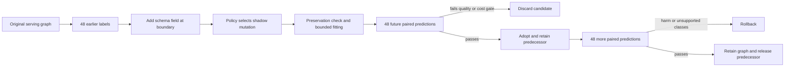
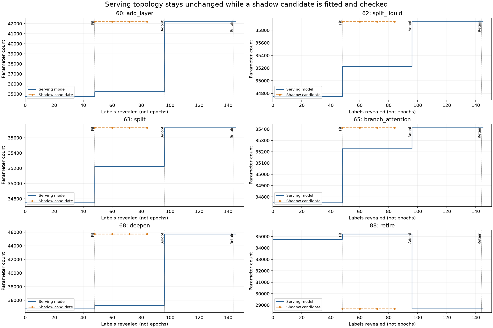
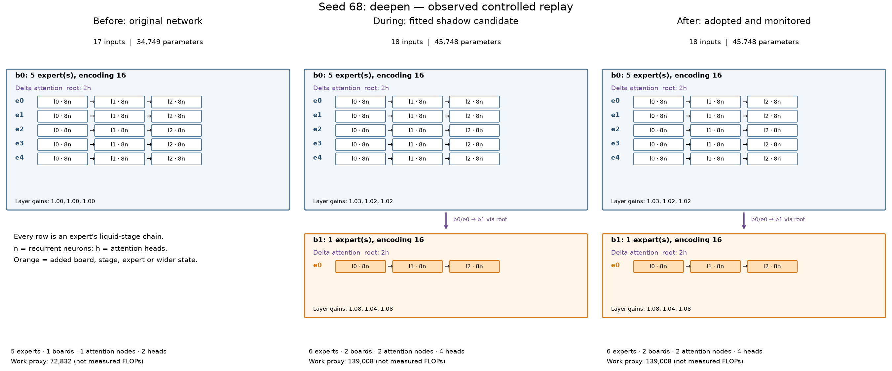
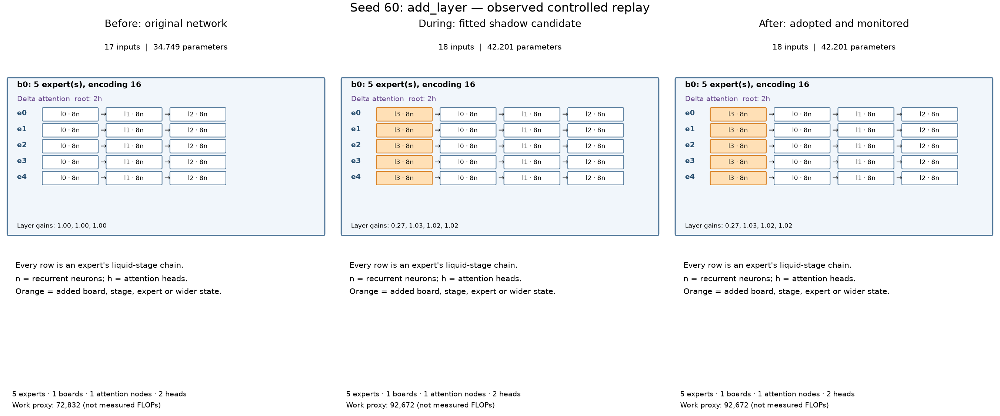
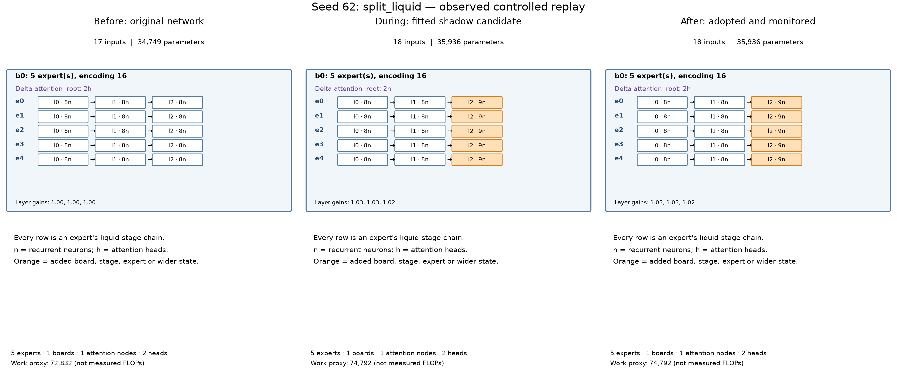
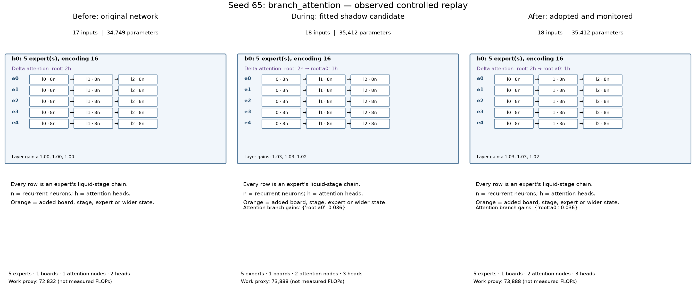
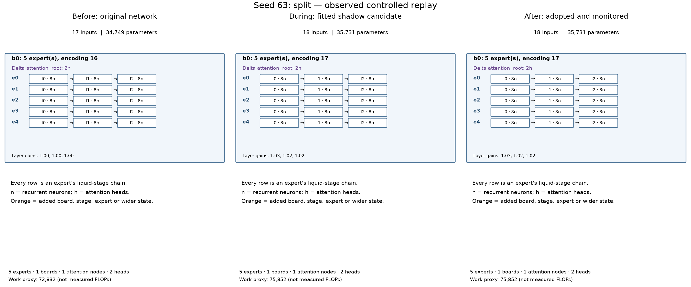
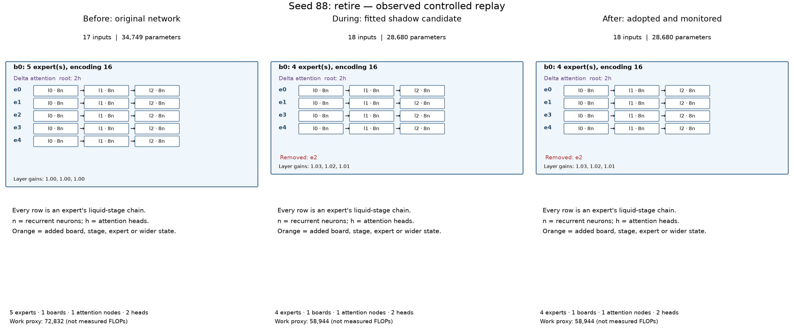
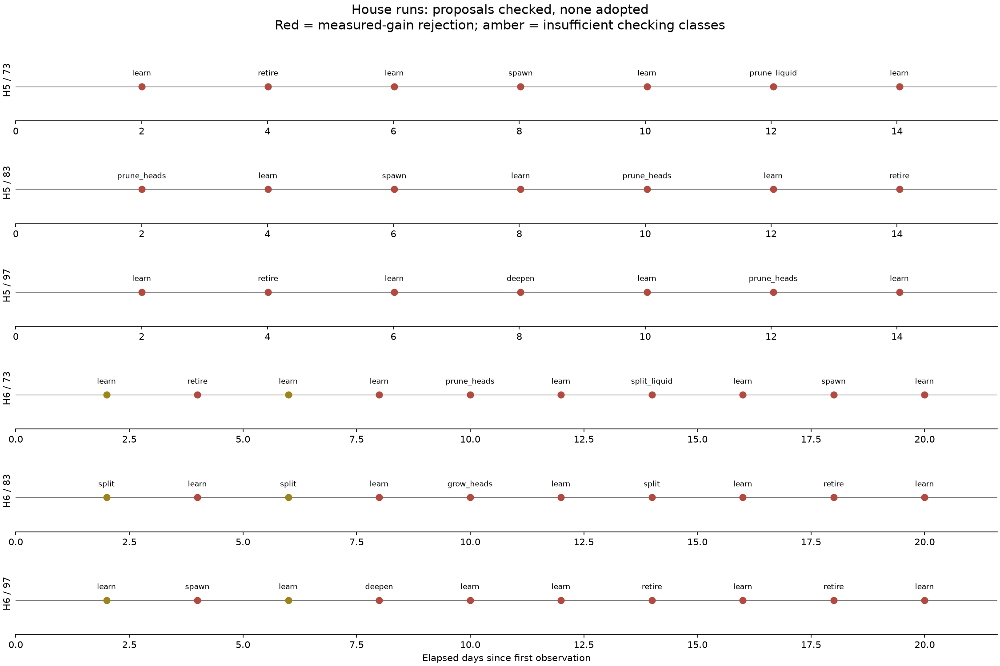

# Inspect the network's evolution

The accuracy graphs are saved as [PNG](trend.png) and [SVG](trend.svg), and embedded in [the results](RESULTS.md). This page adds observed topology and lifecycle views, rather than an illustration of what might grow.

[Open the interactive inspector](evolution/inspector.html). GitHub displays HTML source: download the file and open it in a browser. It works offline with no server or dependencies. Choose a run, move through its six lifecycle boundaries, and switch between the serving model, shadow candidate and monitoring predecessor. Each view includes exact exported topology, stable identities, learned gates, resource counts and a weight digest. The static figures below are directly viewable on GitHub. [Inspector preview](evolution/inspector-preview.png).

The six controlled examples are **separate runs**, not one model growing through six successive changes. They use deliberately informative synthetic input and illustrative seeds. Four reproduce the published predictions, acceptance receipts and final weights exactly; two add examples of encoding widening and child-network growth with the same stream and settings. None establishes that the new topology was necessary for learning that cue.

## The complete learning and adoption cycle



These observed runs all pass both checking and monitoring. Rejection and rollback are supported paths, not additional events invented for these examples. The house runs below demonstrate rejection; the model tests separately exercise rollback.

At the start, the graph has 17 inputs, five experts, three liquid stages per expert, eight recurrent neurons per stage, an encoding width of 16, one delta-attention node and two heads. Every prediction arrives before its label. The new `new:cue` input is queued and then added at the fitting boundary. It is not evidence until the later labels grade it.

| Revealed labels | Observed boundary | Which model serves predictions? |
| ---: | --- | --- |
| 0 | Original graph | Original graph |
| 48 | Shadow transformed, before fitting | Original topology with the newly registered input |
| 48 | Shadow fitted on 38 earlier training rows and 10 earlier validation rows | Original graph; shadow begins prospective checking |
| 96 | Checking accepts the candidate | Candidate; predecessor also runs for monitoring |
| 144 | Monitoring passes | Candidate; predecessor is released |
| 145 | Final saved model | Retained candidate |

All six fits used eight passes and 32 optimizer updates with fixed shapes. Early stopping remained available but did not fire. The new cue is perfectly informative: the candidate reaches 100% balanced accuracy on the independent checking and monitoring blocks versus 50% for its predecessor. Weight learning occurs alongside each structural change; the experiment is not an ablation proving structural necessity.



The orange line is the candidate, not serving capacity. The increase before adoption is temporary candidate allocation; the serving topology changes only at label 96. Total process memory is not equal to either line: it also includes predecessor/candidate copies, gradients, optimizer state and replay. Work scores elsewhere are estimates, not measured FLOPs. [SVG](evolution/lifecycle.svg).

## Child-network growth: one board becomes a hierarchy

Seed 68 selects `deepen`. Root expert `b0/e0` receives a child board `b1` with one expert and three liquid stages. The graph grows from five to six experts and one to two boards. The child has its own delta attention, state and weights, and receives nine selected input fields, including the new cue. Its parent contribution starts at zero; fitting raises the effective contribution gain to about 0.198. The root attention route is one, so this gain is distinct from a learned non-root attention route.



[SVG](evolution/topology-68.svg) · [Full trace](evolution/trace-68.json) · [Saved model](evolution/model-68.pt)

## Liquid layer growth

Seed 60 inserts stable layer `l3` before `l0`, growing each expert's liquid-stage chain from three to four. The new residual coefficient starts at zero, preserving the original public output before fitting. Fitting raises it to about 0.272. The original layers keep their identities and recurrent state mapping despite their new numeric positions.



[SVG](evolution/topology-60.svg) · [Full trace](evolution/trace-60.json) · [Published model](evidence/controlled-60.pt)

## Recurrent neuron split

Seed 62 splits neuron 0 in layer `l2`, taking its recurrent width from eight to nine in each expert's batched layer. It duplicates the donor state, divides outgoing conductance and public readout mass, then learns independent weights. Other liquid layers stay at eight neurons; the public interface remains eight coordinates.



[SVG](evolution/topology-62.svg) · [Full trace](evolution/trace-62.json) · [Published model](evidence/controlled-62.pt)

## Delta-attention branching

Seed 65 adds node `root:a0` with one head beneath the two-head root. The graph grows from one to two attention nodes and two to three total heads. Its contribution starts at zero and grows to about 0.0357 after fitting. It is an added memory branch, not an added child liquid board. Each branch retains the existing elapsed-time forgetting rule.



[SVG](evolution/topology-65.svg) · [Full trace](evolution/trace-65.json) · [Published model](evidence/controlled-65.pt)

## Encoding width split

Seed 63 selects expert `e4` and encoding neuron 2 for a function-preserving widening. Encoding width grows from 16 to 17 across the batched expert tensors. Expert count, recurrent neuron widths, layer count and attention topology remain unchanged. This is distinct from the recurrent-neuron split above.



[SVG](evolution/topology-63.svg) · [Full trace](evolution/trace-63.json) · [Saved model](evolution/model-63.pt)

## Expert retirement

Seed 88 reduces root experts from five to four. The removed expert is absent in the candidate and retained graph; the other experts preserve their identities. Contraction must save parameters or estimated work and pass no-harm checks. Here fitting the new cue also improves both later grading blocks. This demonstrates objective retirement rather than unconditional growth.



[SVG](evolution/topology-88.svg) · [Full trace](evolution/trace-88.json) · [Published model](evidence/controlled-88.pt)

## What actually happened on the house dataset

All six house runs retained the original five-expert, three-layer topology. The 51 completed proposals included weight learning, expert growth, child growth, head changes and retirement attempts. Their receipts record either rejection by measured-gain checks or insufficient checking examples from both classes. There was no adopted structural growth to animate. Some final shadow trials are unfinished and are not included as completed decisions.



[SVG](evolution/house-proposals.svg) · [Machine-readable event list](evolution/house-events.json) · [Scores and resource costs](RESULTS.md)

H5 balanced accuracy matches the previous adaptive model. H6 matches in two seeds and is 0.44 percentage points lower in one; averaged across seeds the difference is about 0.15 points. Starting parameter count is 6.38% higher, and median forward inference is slower on the measured host. These are measured costs of the added flexibility. Finite checks and monitoring cannot guarantee unchanged correctness for every future input.

## Provenance and reproduction

`reporting/evolution.py` observes the unchanged runtime's candidate fitting. It captures actual serving, candidate and predecessor graphs; it does not force actions, change rewards or draw a hypothetical sequence. For seeds 60, 62, 65 and 88, it checks exact equality with the published 145-observation predictions and acceptance receipts, and the final parameter/buffer tensor digest. Each final exported graph is checked against its saved runtime checkpoint. Root model sources and previous evidence are unchanged.

The JSON traces retain all six phase boundaries, sampled parameter/topology counts, learned layer/child/attention gates, raw predictions, paired checking receipts and monitoring audits. They are topology and gate exports, not full intermediate optimizer or recurrent-memory snapshots. The final checkpoint preserves full runtime state. To inspect individual learned tensors, load the linked final model with `Runtime.load`; see [operations](OPERATIONS.md).

```sh
# From this experiment, using its pinned CPU environment:
for seed in 60 62 63 65 68 88; do
  OMP_NUM_THREADS=1 MKL_NUM_THREADS=1 OPENBLAS_NUM_THREADS=1 \
    python reporting/evolution.py capture --seed "$seed"
done
python reporting/evolution.py verify
MPLCONFIGDIR=/tmp/liquid-mpl-cache python reporting/render_evolution.py
# Verify the rendered UI; requires local Chromium:
python reporting/check_inspector.py --screenshot evolution/inspector-preview.png
MPLCONFIGDIR=/tmp/liquid-mpl-cache python reporting/build.py
```

Capture installs the worker configuration's OS address-space, CPU-time and file-size limits before importing PyTorch. Rendering uses Matplotlib from `reporting/requirements.txt`. Rebuilding the report refreshes the artifact manifest. No GPU, GitHub Actions or external service is used. Rendering does not retrain the model. Preserve the published outputs by choosing `--output` for exploratory captures and renders.
