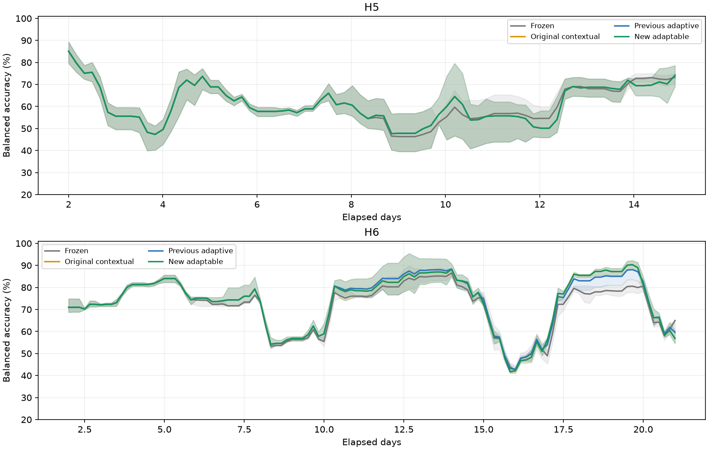

# Measured results

This is a capability extension, not a demonstrated accuracy or efficiency improvement over the preceding adaptive model. The default controller declined structural changes on both house streams in all three seeds. It continued learning weights and liquid state.

## Same-data accuracy

Balanced accuracy after the original 14-day warmup, in percent. Every value is recomputed from committed predictions. Seeds are 73, 83 and 97; these are repeats, not independent houses.

| House / seed | Frozen original | Original contextual | Previous adaptive | New adaptable |
| --- | ---: | ---: | ---: | ---: |
| H5 / 73 | 73.73 | 82.61 | 82.61 | 82.61 |
| H5 / 83 | 73.01 | 87.50 | 87.50 | 87.50 |
| H5 / 97 | 78.99 | 89.86 | 89.86 | 89.86 |
| H5 mean | 75.24 | 86.65 | 86.65 | 86.65 |
| H6 / 73 | 63.42 | 62.54 | 62.54 | 62.54 |
| H6 / 83 | 60.53 | 64.57 | 64.57 | 64.57 |
| H6 / 97 | 62.74 | 62.64 | 63.08 | 62.64 |
| H6 mean | 62.23 | 63.25 | 63.40 | 63.25 |

H5 has only 288 later observations, including 12 vacant examples. H6 has 2,016 later observations. H5 is therefore weak evidence for generalization. The saved receipts also include the original first-week scores, per-class counts, Brier scores and paired trial evidence.

Each curve uses the preceding 576 observations (up to two days), requires at least 16 examples of each class, and is sampled every 48 observations. The line is the seed mean; the band is the seed range. Missing class support produces gaps. Elapsed days include recording gaps. This is descriptive, not a statistical confidence band.

The previous H6 seed-97 run accepted a `learn` update with class-recall gains of 0 and 5.43 points but a quorum change of -1.04 points on its checking block. This experiment defaults to zero permitted quorum loss, so it cannot accept that update under the new gate. Its later balanced accuracy is 62.64% versus 63.08% previously. The tighter acceptance condition has a measurable tradeoff; it does not prove improved future accuracy.

## What the controller actually did

| House / seed | Completed proposals | Adopted proposals | Monitor events | Final experts / boards / attention nodes / heads | Parameters | Work proxy |
| --- | ---: | ---: | ---: | --- | ---: | ---: |
| H5 / 73 | 7 | 0 | 0 | 5 / 1 / 1 / 2 | 34749 | 72832 |
| H5 / 83 | 7 | 0 | 0 | 5 / 1 / 1 / 2 | 34749 | 72832 |
| H5 / 97 | 7 | 0 | 0 | 5 / 1 / 1 / 2 | 34749 | 72832 |
| H6 / 73 | 10 | 0 | 0 | 5 / 1 / 1 / 2 | 34749 | 72832 |
| H6 / 83 | 10 | 0 | 0 | 5 / 1 / 1 / 2 | 34749 | 72832 |
| H6 / 97 | 10 | 0 | 0 | 5 / 1 / 1 / 2 | 34749 | 72832 |

An unfinished proposal is retained in the checkpoint and excluded from completed/adopted counts. The last prediction has no supplied later answer. No house evidence justifies claiming that extra topology helps this dataset.

## Controlled mechanism evidence

These hand-selected mechanism seeds use a perfectly informative new input, not the house dataset. Each candidate is trained on 48 labels, checked on the next 48 predictions and monitored on a further 48. All four completed monitoring and remained adopted. Candidate balanced accuracy rises from 50% to 100% on the checking block. This does not establish that added structure is necessary; ordinary weight learning is also involved.

| Seed | Selected action | Balanced checking gain | Final topology |
| --- | --- | ---: | --- |
| 60 | add_layer | 50.0 points | 5 experts, 4 liquid stages, recurrent widths 8, 8, 8, 8 |
| 62 | split_liquid | 50.0 points | 5 experts, 3 liquid stages, recurrent widths 8, 8, 9 |
| 65 | branch_attention | 50.0 points | 5 experts, 3 liquid stages, recurrent widths 8, 8, 8 |
| 88 | retire | 50.0 points | 4 experts, 3 liquid stages, recurrent widths 8, 8, 8 |

Saved models and detailed raw paired predictions are in `evidence/controlled-*.pt` and `.json`. Unit tests separately exercise contraction, shared-network forks, head bounds, routing, rollback and allocation rejection.

## CPU costs

The new starting model contains 34,749 parameters versus 32,664 previously: 6.38% more. Additional policy actions, liquid readouts and gates have a real cost even when no topology change is accepted. The deterministic work score is a control proxy, not measured FLOPs or wall time.

Isolated forward timing uses the same 160 H5 observations for each saved model, one warmup and three measured passes, one PyTorch CPU thread. Models are measured in separate worker processes after the comparison jobs finish. Timing excludes input packing, learning, checkpoint loading and state detachment. RSS includes imports and loading. Timings describe this host and run, not a portable speed guarantee.

| House / seed | Previous median ms | New median ms | Previous p95 ms | New p95 ms |
| --- | ---: | ---: | ---: | ---: |
| H5 / 73 | 1.361 | 1.909 | 5.221 | 6.398 |
| H5 / 83 | 1.351 | 1.713 | 5.164 | 6.199 |
| H5 / 97 | 1.341 | 1.724 | 1.431 | 1.957 |
| H6 / 73 | 1.450 | 1.734 | 5.183 | 6.004 |
| H6 / 83 | 1.339 | 1.730 | 5.228 | 6.042 |
| H6 / 97 | 1.345 | 1.694 | 3.350 | 3.286 |

Whole-stream prediction and feedback timings are saved separately in each comparison receipt. Those concurrent experiment timings include controller work and are not used as a clean old/new latency comparison.

## Verification and limits

The new 57-test suite, previous 36-test suite and original 20-test suite pass locally. Verification checks source and artifact hashes, all twelve original archive hashes, identical timestamps/truths, recomputed scores and trial decisions, and full checkpoint layout restoration. Controlled checkpoints are restored and their monitoring audits checked. See [TESTING.md](TESTING.md).

The worker bounds address space (4 GiB), CPU time (7,200 seconds), wall time (7,500 seconds) and individual file size (256 MiB). Model allocation estimates and OS process ceilings serve different purposes. Allocation refusal and cancellation cleanup are tested. No GPU or GitHub Actions was used.

Finite prospective checks and a later rollback window cannot prove zero future degradation under arbitrary drift. Labels are required for accuracy gates; external reward is additional contextual-bandit credit. This experiment does not implement a general actor-critic environment trainer.
