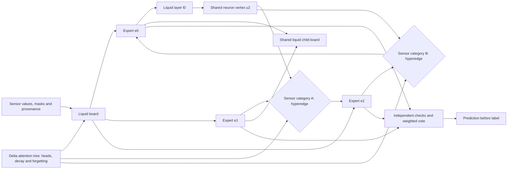
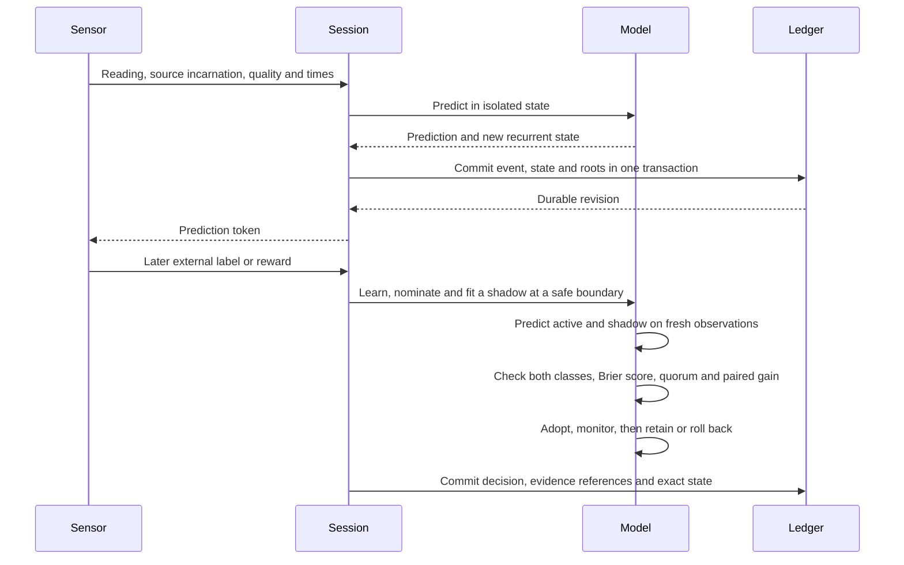

# How the liquid hypergraph runs

## The graph has overlapping memberships

A hyperedge is a relation with several source vertices and several destination
experts. A source vertex can be an expert readout, a liquid layer readout, or
one recurrent neuron. Every vertex uses a stable identity, rather than a tensor index.

For example, `b0/e0/l0/u2` can belong to two sensor groups at once.
Both messages read that same liquid neuron's activation and learned parameters.
Membership does not clone its weights. Different messages have separate learned readouts.



The drawing shows the kinds of allowed memberships. Generated evolution files show
the exact memberships used in each recorded run.

## A bounded message changes the neural calculation

`Core.stages` first computes the original liquid expert states and margins.
`Graph.hyper_messages` then applies each local hyperedge once during that round.
The existing checker, retry and vote logic receives the amended margins.

For edge `e`, the source vector is the mean of its selected liquid vertices.
An entire layer uses its existing eight-coordinate readout. A single neuron uses
its activation multiplied by its row in that readout matrix.

```text
z_e = mean(selected liquid source vectors)
message_e = mass_e * tanh(gain_e) * tanh(readout_e(z_e))
amendment_e = message_e * delta_route_e(old_memory, query) * source_present_e
destination_margin += amendment_e
```

The edge's sensor fields determine `source_present`: at least one selected reading
must be present. Missing, broken and stale readings become missing inputs.
The existing liquid model also receives a validity mask for each sensor.

The root attention route is one. A selected attention branch uses its old delta
memory to gate the message. Delta memory still writes through the existing learned
forgetting rule. Newly added attention branches begin with private zero memory.

All messages read the liquid states computed before message amendments.
An amendment cannot recursively trigger another amendment in the same round.
This permits overlapping source/destination memberships without an unbounded graph loop.
Child boards retain the existing bounded retry schedule and depth limits.

A newly connected edge starts with gain zero. It preserves the original function
before fitting. A split or merge of nonzero messages does not generally preserve
the function, because their readouts are nonlinear. Such candidates require fitting
and fresh prospective checks. The code never asserts that correlation proves equivalence.

## Four kinds of sharing have different meanings

| Sharing | Implementation | State and training behavior |
| --- | --- | --- |
| One vertex in several categories | Several hyperedges name the same stable expert/layer/neuron | Each message reads the same activation in that calling context. Gradients accumulate into its source parameters. |
| One child board called by several parents | Existing graph edges point to one child identity | Weights are shared. `GraphState` stores separate state under each parent path. |
| Exact liquid layers or whole kernels | `tie_layer` or `share_equal` aliases the same module | Joint training updates the shared parameters. Structural edits detach affected shares first. |
| Equal tensor payloads in saved models | The ledger stores one immutable object per dtype, shape and content | Loading creates separate mutable tensors. Storage deduplication does not create parameter tying. |

Exact layer sharing checks every tensor, shape and stable unit identity first.
The next layer, readout, policy and checker can remain distinct.
An unrelated layer with different weights cannot become shared by hash similarity.

## The existing adaptive controls remain

The copied runtime still measures error, error drift, plateau, gradients, activity,
age and resource pressure. It keeps cooldowns and a minimum lifetime.
Its neural policy retains these actions:

- Fit existing weights; split or retire experts; create or retire child boards.
- Split or prune encoding and recurrent neurons.
- Add or remove liquid layers.
- Grow or shrink attention heads; branch or prune the attention tree.
- Share equal networks/kernels, or fork a shared child into an independent model.

The extension adds `connect`, `split_edge`, `merge_edge` and `retire_edge`.
All actions use the same isolated candidate, resource reservation, fitting,
prospective decision, monitoring and rollback path.

The model changes architecture at safe boundaries between these stages.
Inference updates liquid state immediately. Labels can subsequently cause learning
and a structural proposal. Without labels, the model cannot certify a structural gain.
Pending-label capacity is bounded; callers must label or discard predictions.

## Similarity adds evidence to the decision

[hypergraph.py](hypergraph.py) measures paired expert predictions on the same
observations. Each record contains observation IDs, label IDs, model revisions,
class counts, contexts, window endpoints, metric version and configured thresholds.
Repeated observation IDs count once, even across overlapping windows.

The measurements are:

- Pearson correlation of expert predictions, with constant signals marked undefined.
- Mean absolute prediction disagreement, to detect different calibration.
- Linear centered kernel alignment of expert representations.
- Context-specific residual differences, to nominate different recurrent demands.

High correlation plus small absolute disagreement nominates possible redundancy.
Different residual behavior across sufficiently populated contexts nominates a split.
These are point measurements, not significance tests or independent confirmations.
Representation alignment is recorded for inspection; it does not independently authorize a merge.

Growth still requires the existing controller's growth pressure and resource checks.
Pruning still requires its lifetime/activity checks. The learned action values choose
among eligible proposals. A nomination alone changes neither topology nor weights.

The current edge merge combines source memberships in compatible board, field,
target and attention contexts. It is an approximate behavioral proposal.
Expert contraction uses the existing checked retirement action; tensor sharing
requires exact equality. The experiment does not average arbitrary unequal tensor
weights and call the result an equivalent model.

## Fresh labels decide whether to keep a candidate



Growth and learned weight changes require the configured accuracy and Brier gains,
a positive paired lower bound, and class/quorum checks. Contraction requires measured
resource savings without class, Brier or quorum loss. Monitoring can still roll back.
These finite checks constrain observed loss. Future distribution changes can still
cause degradation, including in a liquid model.

## Features and labels have different authority

`Session.derive` records a bounded mean or difference of named sensor fields.
The definition retains source names and a valid evidence event.
It enters the same labeled schema-growth path as a newly installed sensor.
Unfitted inputs cannot silently influence predictions.

Feature definitions are explicit requests in this experiment. The controller does
not invent unrecorded transformations or semantic targets.
Context groups are not ground-truth classes. Occupancy labels remain externally
measured binary answers with an authority and schema version.

## Recovery and orphan collection preserve meaning

An event revision commits the request, result, dependencies, exact runtime state,
tensor objects and serving root in one SQLite transaction. The expected revision
rejects stale writers. Repeating an event ID with identical input returns its
committed result; changing that input is rejected.

Tensor addresses include dtype, shape and canonical bytes. Manifests reference those
objects. Recovery verifies hashes and restores committed tensors, topology, pending
labels, shadow/fallback models, feature definitions, recurrent state and random state.
It does not replay stochastic training to guess the old weights.

Every transition depends on its previous model event and direct evidence events.
A correction appends a new event and invalidates dependent evidence in a derived
validity table. Original event bodies stay intact. The affected model is quarantined.
Restore a retained clean revision, or retrain from clean data before resuming.

Collection starts from the serving snapshot, configured recent revisions and explicit
pins. A full snapshot includes its shadow, monitoring fallback, replay and pending
states, so their objects remain reachable too. Shared payloads survive while any
root uses them. Unpinned old payloads may expire; their event headers and lineage remain.

This is a single-host ledger. It has no distributed consensus or multi-GPU trainer.
Pins do not expire automatically: explicit ownership avoids a time-based cleanup
deleting an in-flight audit. Record and disk ceilings refuse new commits when full.
Branch a retained snapshot into a new ledger to start a new bounded recovery horizon.
