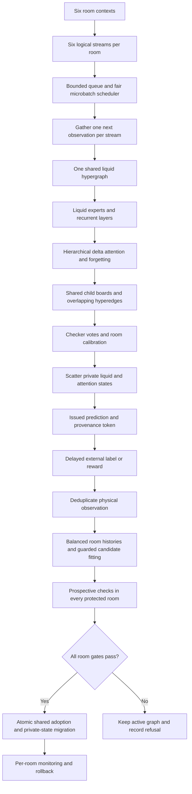

# One model with independent temporal contexts

The model stays liquid. Every expert contains recurrent liquid neurons; elapsed
time changes their state even when weights remain fixed. Multi-head delta memory
retains and forgets information. Experts can call smaller liquid boards, and boards
can share complete kernels or exact layers. Hyperedges connect overlapping expert,
layer and neuron memberships through learned messages. No feed owns a copy of the
learned trunk.

## Ownership

| Object | Ownership | Why |
| --- | --- | --- |
| Liquid weights, topology, experts, subexperts, hyperedges | One model | Learn common structure without making 36 models |
| Structural policy, controller and version | One coordinator | Every stream sees one committed architecture |
| Liquid cells and elapsed times | One logical stream | Room histories cannot overwrite each other |
| Delta memory and child-path clocks | One logical stream and call path | Shared weights do not imply shared temporal memory |
| Candidate and fallback temporal states | One logical stream | Prospective comparisons and rollback use independent trajectories |
| Calibration correction and calibration learner | One room | Duplicate room feeds cannot train the correction six times |
| Pending labels, ordering and queue entries | One logical stream | A delayed room does not impose a global label barrier |
| Shared fitting history and quality report | Balanced by room | A fast stream cannot hide another room's loss |
| Evidence identity | One underlying observation | Replicas are execution work, not new statistical support |

One process owns the coordinator. Logical stream identity is independent of CPU
threads, GPU streams and batch position. CPU and accelerator paths use the same
stream semantics. The optional accelerator backend mirrors a fixed CPU-owned graph;
its fingerprint invalidates the mirror after a weight or topology change. It does
not implement distributed training or simultaneous mutations in different threads.

## Time and feedback

`MultiRuntime.predict_batch` takes at most one next sample per stream. `batching.py`
gathers private cells and memories, runs the shared graph, and scatters cloned states.
Each batch row carries its own timestamp and positive elapsed time. A child context
that was never entered remains absent; a presence mask prevents another batch row
from creating a false child clock for it.

Physical event time drives liquid dynamics. A monotonically increasing coordinator
sequence records prediction and feedback availability for fit/check separation.
Feedback must follow prediction order **within its stream**. Different streams can
reveal labels in different orders, including streams belonging to the same room.
Room calibration has its own availability sequence and replays each stream using
its actual physical clock and recorded pre-event state. Fitting labels must have
been revealed before the first checking prediction was issued. Checking predictions
that predate the last accepted calibration cannot approve another calibration.

A label issued against an older graph version still contributes its original
prediction to scoring and its revealed data to shared fitting. It cannot replay an
incompatible old liquid state through the current calibrator; that skip is counted.
It never becomes a fresh candidate prediction after the fact.

## Learning and shape changes

Shared fitting uses bounded room histories. When a history is full, the oldest
example of its most frequent class is removed. This preserves minority examples
through long occupied or vacant periods. Equal room-tail lengths bound how much
one room contributes to a stage. New fields queue until an isolated schema stage;
their contributions remain disabled until trained.

The inherited controller nominates weight learning, expert and subexpert changes,
liquid layer or neuron changes, attention changes, exact sharing, and hyperedge
connect/split/merge/retirement. A fresh optimizer is created for each fitting stage;
parameter shapes remain fixed inside that stage. Expansion has a preservation
check against every open stream's state before candidate fitting. New candidate
states align by stable expert, layer, neuron, head and path identities.

A candidate receives only already revealed fitting labels. Later predictions form
its prospective check. Each protected room must provide a full bounded check with
both classes. A fast room's surplus is capped. Aggregate quality gates still apply;
an additional room gate vetoes any room with worse class recall, balanced Brier
error or quorum coverage. Resource savings cannot override that veto. Environment
rewards train the policy but cannot bypass measured quality.

Adoption moves every stream's shadow state into its active slot together. Monitoring
uses private fallback trajectories and the same room veto; harm or insufficient
support rolls the graph back. A configured timeout rejects unsupported trials or
restores the fallback graph. Inference continues while a slow room lacks evidence;
a shared change may wait or expire. Finite checks do not prove accuracy on all
future inputs.

## Files and responsibilities

| File | Responsibility |
| --- | --- |
| `graph.py`, `liquid.py` | Liquid cells, executable graph, vector clocks, presence masks and identity migration |
| `attention.py`, `hierarchy.py` | Delta-memory heads, forgetting and nested attention branches |
| `hypergraph.py` | Similarity evidence, overlapping memberships and higher-arity messages |
| `runtime.py`, `control.py`, `policy.py` | Candidate fitting, structural actions, budgets, rewards and prospective lifecycle |
| `multistream.py` | Stream ownership, room calibration, deduplication, fair histories and room gates |
| `batching.py` | Explicit gather/scatter and CPU or accelerator tensor execution |
| `adaptation.py` | Recorded-state contextual fitting with causal fit/check separation |
| `session.py`, `ledger.py`, `provenance.py` | Atomic events and snapshots, evidence ancestry, corrections and recovery |
| `cold_start.py`, `stream_replay.py` | Separate offline-bootstrap and live empty-model experiments |
| `worker.py` | Hard process memory, CPU, wall-time and file limits |

## Sources behind the design

Explicit state IDs and sequence ordering follow the same ownership concern as
[Triton's stateful sequence batching](https://docs.nvidia.com/deeplearning/triton-inference-server/user-guide/docs/user_guide/implicit_state_management.html).
This experiment owns those rules directly; it does not require Triton.
[PyTorch documents accelerator stream ordering](https://docs.pytorch.org/docs/2.7/notes/cuda.html);
creating more GPU streams does not itself isolate recurrent state.
[Net2Net](https://arxiv.org/abs/1511.05641) motivates preservation before growth.
[R2D2](https://openreview.net/pdf/387fb2fcee8f74c53cf707a9856f40c458f33933.pdf)
explains the state-staleness problem that makes saved-state compatibility and replay
necessary. These sources motivate engineering choices; they are not evidence of
this experiment's accuracy.
