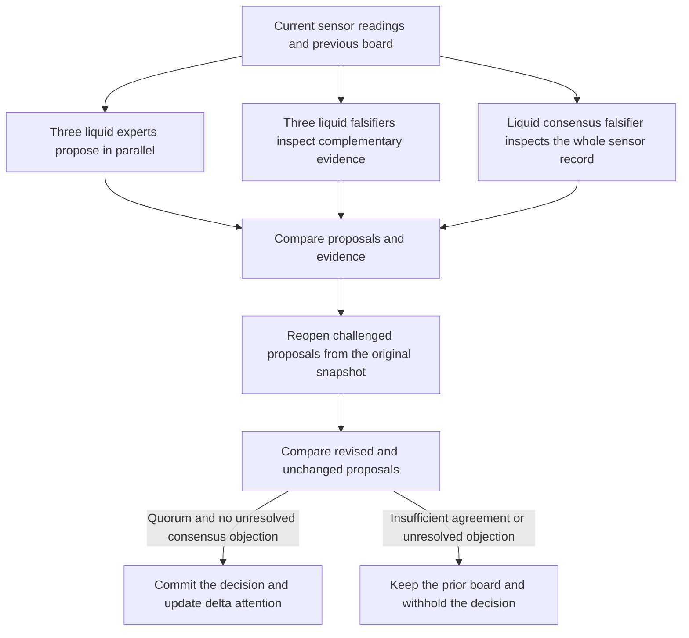

# Liquid blackboard for sensor decisions

A liquid mixture of experts that makes and revises a shared decision. The
occupancy model uses public sensor data from six homes. The heater model
learns from measured commands, energy and temperature in a public building
log. Each task has its own checkpoint.

## Run and inspect it

Use Python 3.12 and PyTorch 2.7.1. The recorded runs used the CPU wheel.

```sh
python -m pip install torch==2.7.1
python -m unittest -v
python serve.py heat evidence --live --trace-updates < examples/heat.jsonl
python serve.py occupancy evidence --live --trace-updates < examples/occupancy.jsonl
```

Every decision names the sensor evidence, shows all three initial
proposals, lists the experts asked to revise, and shows the final
proposals and the commit decision. A null decision leaves the prior board
intact. The input examples use normalized readings from the test logs.
A heating decision of 0 means off and 1 means on. For occupancy, 0 means
vacant and 1 means occupied. The output is JSON Lines, one object per line. With `--trace-updates`, a
weight-update record follows the decision that was emitted before the
update. Use `--save-adapted /path/to/new-file.pt` to save adapted weights
to a separate file at the end of a live run.

## How a decision moves through the board



The experts execute as a single tensor batch. For occupancy, the three
views cover air readings, thermal and humidity readings, and light and
related changes. Each expert has its own liquid differential equation,
hidden state and two decision scores. Each reviewer uses inputs outside
its expert's view. The consensus reviewer sees the full input. A reviewer
can challenge a proposal when it scores the other decision highly enough
or when it corroborates the competing proposal in a split vote.
The affected experts run once more from the pre-decision snapshot. They
receive the direction of the objection as an input. Unaffected proposals
stay as they were. At least two eligible votes must support the proposed
decision. The heater also reopens proposals to leave heat off when the
indoor sensor reads below 20 °C.

Successful commits retain the sensor evidence, votes and decision on the
board. They also write a summary to the delta-attention memory, which the
next experts can read. A failed commit restores expert and reviewer states
as well as attention memory. The trace retains the rejected attempt for
inspection. Sensor evidence shared across rounds is fixed for each
decision. The learned reviewers can be wrong. Their objections express a
conflict in the available evidence.

## What changes at inference time

The forecast starts with the current reading and predicts how much it will
change. The next reading grades that forecast. That is
self-supervised learning because the sensor supplies the target. The
occupancy model receives no occupancy label during inference. For heating,
a separate loss uses the previous **executed** action and its measured
reward. The reward subtracts the measured energy in kWh and twice the accumulated
degree-hours outside 20–24 °C. The Bellman target adds
95% of the next estimated return. The heater learns action values from
historical outcomes and never sends actuator commands. Live replay keeps
the same recorded outcome stream whichever action the model proposes.

The model emits the current decision first and then applies one
gradient-clipped update. This can change the learned coefficients inside
the liquid differential equations. The hidden states also evolve between
updates. The receipt counts updates and reports how much the expert and
reviewer parameters moved. A gap starts a fresh state and breaks the
feedback link.

## Reproduce the fits

Get the environmental and ground-truth archives for H1 through H6 from
[HPDmobile](https://www.nature.com/articles/s41597-021-01055-x). The table
gives the Figshare download file IDs. Place the archives in one directory
using their original names. The example readings are derived from the
public data, and their timestamps are expressed as seconds from the first row.

| Home | Environmental file ID | Ground-truth file ID | Use |
| --- | ---: | ---: | --- |
| H1 | 27443549 | 27443552 | Fit |
| H2 | 27443693 | 27443690 | Fit |
| H3 | 27443747 | 27443738 | Fit |
| H4 | 27443819 | 27443813 | Pick checkpoint |
| H5 | 27443894 | 27443882 | Replay |
| H6 | 27443933 | 27443936 | Replay |

The download URL for an ID is `https://ndownloader.figshare.com/files/ID`.
The occupancy loader uses all available hubs. At each five-minute
boundary it combines the latest observation per hub and field in that
window. The gas and light readings use the highest value across hubs,
while temperature and humidity use the median. It also supplies changes
from the preceding window. The occupancy label applies to the entire
house. The loader takes 14 complete labeled days from each fitting home
and seven from each other home. H5 and H6 were previously used in the
preceding experiment and are held out from this fit and checkpoint
selection. The new benchmark uses a different sensor and row selection.

Get `six-buildings.zip` from the [measured building
logs](https://data.mendeley.com/datasets/xztfbtsgys/3), using the archive
and naming convention in the [building-control example](../building-control/README.md).

```sh
python train.py occupancy /path/to/hpd-archives run-output --epochs 22
python train.py heat /path/to/six-buildings.zip run-output --epochs 30
```

Fitting uses chronological sequences, with three context rows before
scoring. The occupancy checkpoint maximizes balanced accuracy on H4,
giving occupied and vacant rows equal weight. When candidates tie, it
uses how well the scores rank occupied above vacant windows. After picking
the checkpoint it calibrates each expert and reviewer threshold on H4.
A withheld answer counts as wrong. The heat checkpoint minimizes the error against discounted
logged outcomes on its validation split. Both runs stop after five
epochs without validation improvement and save the best checkpoint.
The receipts contain the input and code hashes, fit curves, replay scores
and selected decision traces.

## Measured replay results

| Held-out home | Frozen coverage | Frozen balanced accuracy | Live balanced accuracy | Logistic baseline |
| --- | ---: | ---: | ---: | ---: |
| H5 | 82.8% | 46.1% | 46.1% | 46.1% |
| H6 | 99.95% (one withheld) | 50.1% | 50.1% | 67.4% |

On H5 the frozen board challenged 1,005 proposals and 17 experts
changed their vote on revision. On H6 it challenged 920 and six changed
their vote. These counts refer to proposals, so one row can contribute
multiple objections. The [repair trace](evidence/repair-example.json)
shows one H5 vote changing from occupied to vacant. The recorded label was
occupied, so that objection shows a learned falsifier making a mistake.
Inspect it alongside
the full [occupancy receipt](evidence/occupancy.json). On H6, the scores
ranked occupied above vacant rows better than chance, but the decisions
at the operating threshold missed nearly all occupied rows.

Live updates reduced sensor forecast error slightly compared with the
frozen model. Keeping the previous sensor reading still gave a lower
error on both homes. The heater applied 492 reward updates across 533
held-out rows. Its logged-return error went from 3.283 frozen to 3.297
live, and both runs proposed off for all 533 rows. The archive gives one
measured outcome per interval, so the [heater receipt](evidence/heat.json)
cannot establish the energy or comfort of a different policy.
